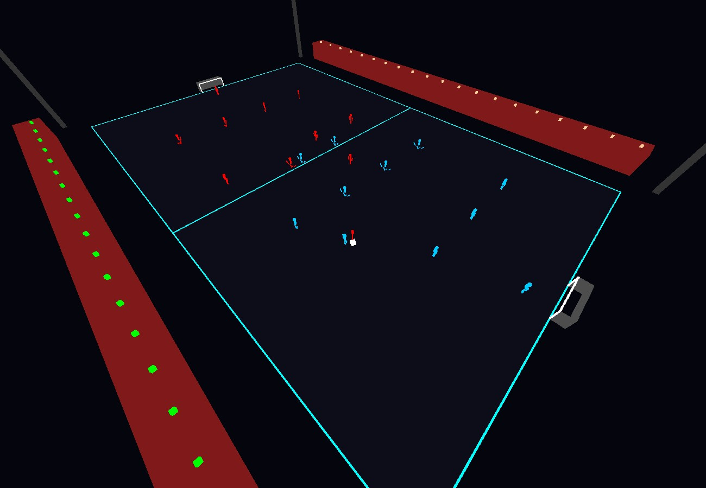
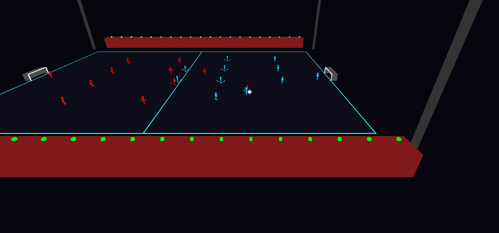

# galactic-football

An 11-a-side arcade football game in C++ and OpenGL, with no engine: stick-figure humans against an alien team, on three pitches where the ball behaves differently. Physics, AI, set pieces and rendering are all written here; Dear ImGui draws the HUD.



It also has a headless simulator. It plays the AI against itself, thousands of matches at about 50,000 times real time, and checks every step for things that should never happen. The first run found four AI bugs: some matches never produced a goal, ice matches ended 31-0, and the ball sometimes left for the stratosphere. They are fixed now.

## The game

- **Pitches** (`--terrain`): neon grid (normal), ice (the ball barely slows down) and mud (the ball stops quickly). Each sets the ball friction.
- **Aliens** (`--aliens`): brutes run at 4 m/s, speedsters at 9 m/s. Teleporters have no special move yet and run like the humans, at 6 m/s.
- **Ball:** gravity, bounces, lofted passes and crosses. Clicking the pitch passes to the cursor, using a ray cast from the mouse into the scene.
- **AI:**
  - the nearest player chases a loose ball or presses the carrier;
  - attackers and midfielders make supporting runs, defenders hold their line;
  - a carrier under pressure passes to the most open teammate;
  - wide players cross from the final third;
  - the goalkeeper moves along an arc to cut the angle, and rushes the ball in the box.
- **Rules:**
  - Kickoffs.
  - Fouls: a slide tackle from behind is a foul 80% of the time, from the front 10%.
  - Free kicks within 25 m of goal, with a four-player wall 9.15 m away.
  - A three-minute match.
- **Cameras:** follow, player, top-down and side TV.

| key | action |
|---|---|
| arrows | move |
| C (hold) | sprint |
| Q | switch to the player nearest the ball |
| Z | dash / skill move |
| X (hold, release) | ground pass, harder the longer it is held |
| D (hold, release) | lofted pass; a tackle when defending |
| W (hold, release) | through ball |
| A (hold, release) | shot |
| left click | pass to the cursor; double click lofts it |
| 1 to 4 | cameras |

## Headless simulator

`soccer_sim` builds without OpenGL. It runs full matches on a fixed 60 Hz step, using the same update order as the game loop. Both teams use the same AI, and kickoffs take themselves. Each kickoff moves every player up to 0.5 m from their formation spot, because the AI is otherwise deterministic. After every step it checks for:
- positions that are NaN or infinite;
- the ball or a player off the pitch, or the ball higher than 50 m;
- the ball stuck within 3 m of one spot for 30 s;
- a kickoff or free kick not taken within 10 s.

```bash
./soccer_sim --matches 270 --seed 1 --check    # exit code 1 if any match broke a rule
```

It covers all 9 combinations of pitch and alien type, about 830 match-minutes per second on one core. CI runs it on every push.

### What it found

There were 270 matches at each stage (30 per pitch and alien type), seed 1. Each row adds one fix:

| state | goals per match: neon / ice / mud | stalls | broken matches |
|---|---|---|---|
| original AI, both teams | 0 / 31.3 / 0 | 135 | 42 |
| cross lift fixed | 0.02 / 31.3 / 0 | 135 | 0 |
| tackles: 0.5 s protection | 0.13 / 30.1 / 0.33 | 176 | 0 |
| keeper kicks the ball out | 0.09 / 0.08 / 0.29 | 183 | 0 |
| arrive steering | 0.31 / 0 / 2.01 | 0 | 0 |

1. **The ball went to 30 km.** The AI cross set the ball's vertical direction to `kick_power * 1.5 * 0.6 = 22.5`, and `kick()` then multiplied by the power again. The ball left at about 840 m/s upward and came down roughly 170 s later, near the end of the match. The vertical component is now 0.5, the same as the player's lofted pass. This fixed the 42 broken matches.
2. **Tackle ping-pong.** A standing tackle only needs an opponent within 1 m moving faster than 1 m/s. Two players side by side therefore took the ball from each other on every frame, for minutes. The player who wins the ball now cannot be tackled for 0.5 s.
3. **Own goals on ice.** A goalkeeper who caught the ball stayed in "rush the ball" mode. The ball sits 0.8 m in front of him, so he walked it over his own line. On ice every kickoff (a full-power shot) reached the keeper, which gave about 31 goals a match. The keeper now kicks the ball to the most open teammate.
4. **Players orbiting the ball.** Movement added `accel * dt` towards the target and only capped the speed, so sideways velocity never decayed. A fast player circled the ball at the turning radius v²/a (4 m for a speedster, 2.4 m for a human) and never got within the 1 m needed to pick it up. That caused every stall. Players now steer towards a desired velocity, slowing within 2 m of the target ("arrive" steering), and change velocity by at most `accel * dt` per step.

The tackle fix raised the stall count at first. Ending the ping-pong left more loose balls, and players orbited those instead, which stayed until the steering fix.

The interactive game had the same bugs. The cross and keeper bugs hit the alien team, which the AI controls. The steering and tackle bugs hit every AI player. One loop remains: on ice the AI defenders pass among themselves for most of the match (93 to 98% possession). The ball moves faster than the chasers, so nothing breaks, but it is dull to watch.

## Build and run

```bash
# macOS
brew install glew glfw
# Debian / Ubuntu
sudo apt install libglew-dev libglfw3-dev zlib1g-dev

make && make soccer_sim && make test
./galactic_football                 # play
./galactic_football --watch         # the ai plays itself
./galactic_football --terrain ice --aliens speedster
./galactic_football --shot match.png --seconds 25 --camera 0 --terrain ice
```

`--shot` plays the given number of seconds without a window, then renders one frame offscreen to a PNG. The images here were made that way. Sound uses `afplay`, so it only works on macOS.



## Layout

```
main.cpp        window, game loop, watch mode, png capture
game_state.*    match phases, kickoff, free kicks, scoring
entities.*      ball and players, ai, steering
physics.*       friction per pitch, goals, ball claiming, tackles and fouls
input.*         keyboard and mouse, charged kicks
renderer.*      cubes into stick figures, stadium, cameras, hud
sim_main.cpp    headless ai vs ai simulator
imgui/          Dear ImGui 1.92.7 (MIT)
```
